


 

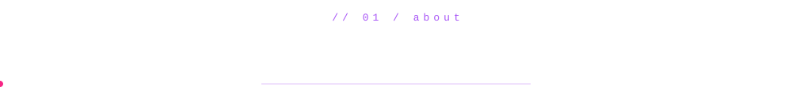

<table width="100%">
<tr>
<td width="28%" align="center" valign="middle">
  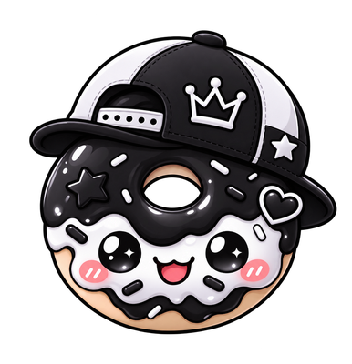
   <b>DONUT KING 🍩👑</b>
</td>
<td width="72%" valign="top">

Saya pelajar **Software Engineering** di **SMK Swasta Mandiri** yang suka membuat website estetik, modern, dan berkinerja tinggi, dengan fokus pada pengembangan web interaktif (Frontend & Backend).

- 🎒 **Pendidikan:** Siswa SMK Swasta Mandiri
- 💻 **Keahlian:** HTML5, CSS3, JavaScript, PHP, MySQL, Bootstrap, Tailwind
- ☕ **Hobi:** Ngoding, anime, musik Lo-Fi, dan kucing lucu 🐱
- 🎯 **Tujuan:** Senior Fullstack Developer & Software Architect

> *"Still learning. Still building. Still improving."* ☕⚡

</td>
</tr>
</table>

<a href="#"></a>
<a href="#"></a>
<a href="#"></a>
<a href="#"></a>

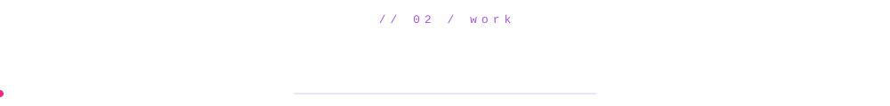

<table width="100%">
<tr>
<td width="50%" align="center"><a href="https://mom4gwebsite.page.gd/"></a></td>
<td width="50%" align="center"><a href="https://warungterasbarokah.github.io/warungteras/"></a></td>
</tr>
<tr>
<td width="50%" align="center"><a href="https://rajakoto68.github.io/motor/"></a></td>
<td width="50%" align="center"><a href="https://unimedfbs1.page.gd/fbs/index.html"></a></td>
</tr>
<tr>
<td width="50%" align="center"><a href="https://mimocoo.page.gd/?i=2#home"></a></td>
<td width="50%" align="center"><a href="https://rajakoto68.github.io/rasamanado/"></a></td>
</tr>
</table>

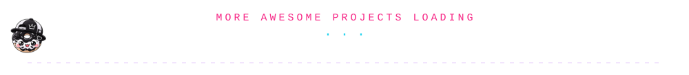

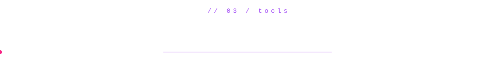

  

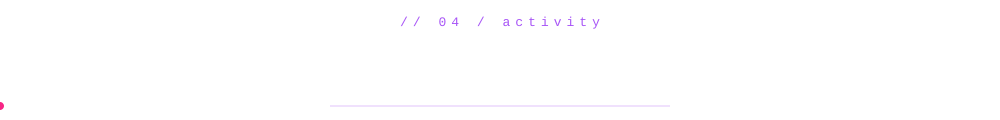

<picture>
  <source media="(prefers-color-scheme: dark)" srcset="https://raw.githubusercontent.com/rajakoto68/rajakoto68/output/github-snake-dark.svg" />
  
</picture>

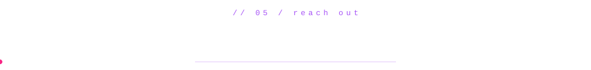

  

*"A little curiosity, a lot of trial and error, and one more website."*

**Still learning. Still building. Still improving.**

